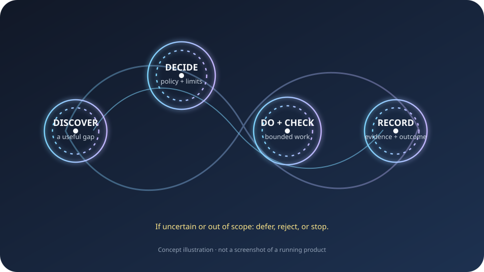

# gnognote0

**An experiment in useful autonomy, with guardrails you can inspect.**

What would it take for an AI system to find a worthwhile task, do the work, and show its receipts—while knowing when to stop? gnognote0 explores that question through an evolving engineering project and a public-benefit hurricane-preparedness knowledge tool.

> This repository is a public project showcase, not the private development source. It describes experiments and locally verified candidates. It does not claim a production-ready autonomous agent, formal acceptance, or a public interactive experience.

## The idea

Autonomy is more than a model responding to a prompt. A useful system needs persistent context, a way to identify and prioritize work, bounded tools, durable decisions, recovery after interruption, and evidence that lets someone else see what happened. It also needs a credible way to decline work that falls outside its authority.

gnognote0 brings those engineering questions together with a creative ambition: an AI character whose evolving work can eventually be observed and gently influenced, without giving an audience control over the system's purpose or safety limits.

## What has been demonstrated locally

A recent offline development run selected a small maintenance gap in a hurricane-preparedness knowledge package and completed a saved-source-review filter. The candidate makes recorded review states easier to distinguish while keeping the experience offline. Package integrity, local navigation, browser behavior, syntax, and focused regression checks were recorded.

That is a bounded local engineering demonstration. It is not formal requirement acceptance, independent usefulness evaluation, a long-duration soak, or a deployed service. See [the G0 case study](docs/g0-case-study.md), [status and roadmap](docs/status-and-roadmap.md), and [test evidence](docs/test-evidence-summary.md).

## A system with boundaries

The intended system separates discovery, decision, bounded execution, and evaluation. Codex and other AI-assisted coding tools help build gnognote0; that development assistance is distinct from the autonomous runtime being explored. [Architecture](docs/architecture.md) explains the distinction.

## Explore

- [Concept](docs/concept.md)
- [Architecture](docs/architecture.md)
- [Autonomy and governance](docs/autonomy-and-governance.md)
- [G0 public-benefit case study](docs/g0-case-study.md)
- [Engineering journey](docs/engineering-journey.md)
- [Status and roadmap](docs/status-and-roadmap.md)
- [Test evidence and limits](docs/test-evidence-summary.md)
- [Daily update workflow](docs/daily-updates.md)
- [Development log](docs/development-log.md)
- [LinkedIn introduction draft](linkedin-post.md)

## Scope and release status

This public showcase contains no application source, private project history, operational configuration, credentials, private evaluation records, or third-party source documents. No open-source license is included. The LinkedIn post is an unposted draft for its author to review and publish personally.
