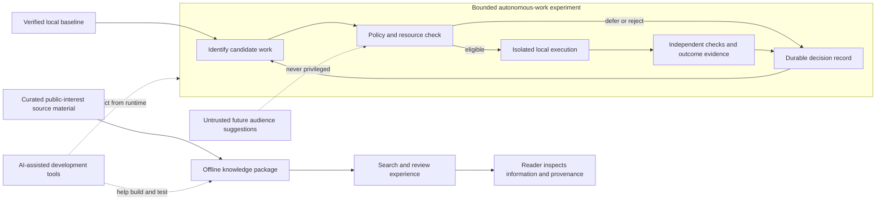

# Architecture at a glance

The diagram shows the development model being explored. It is a conceptual overview, not a deployed system diagram.

## Boundaries

- The knowledge experience can be built as a self-contained offline package; a package candidate is not the same as a formally accepted public product.
- Work discovery and policy checks are separate from execution. A request or suggestion cannot grant capabilities.
- Execution experiments are local and bounded. External providers, public interaction, and production operations are outside the claims made here.
- Evidence records distinguish a successful local check from independent evaluation or formal acceptance.
